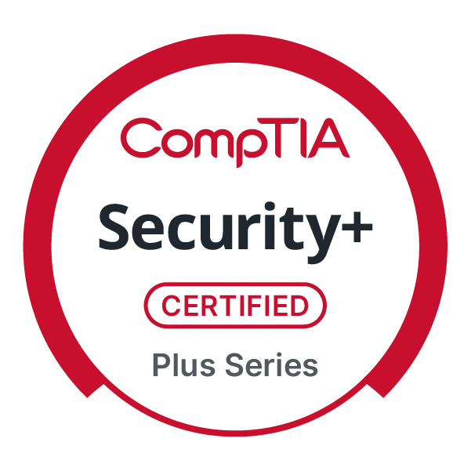
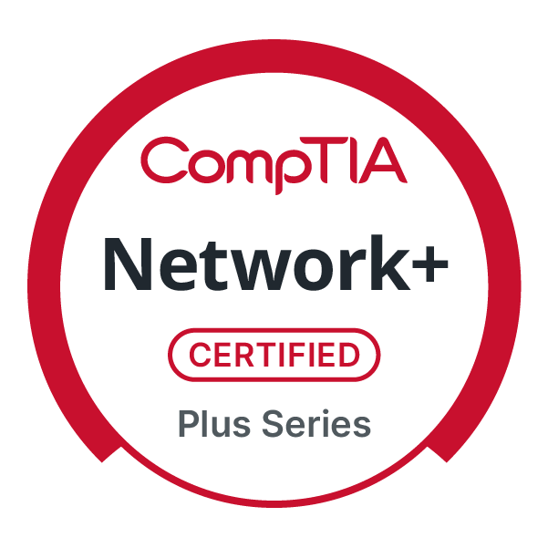
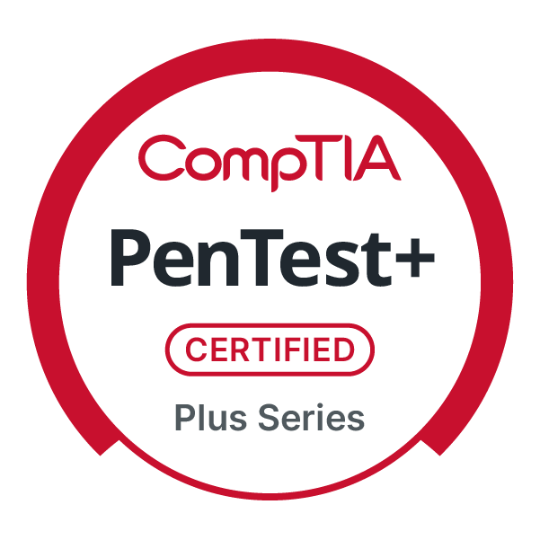
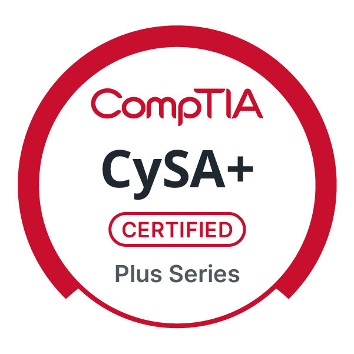
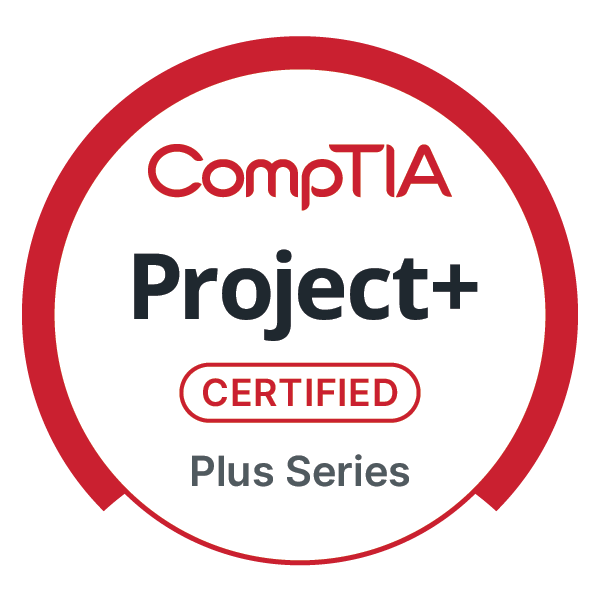
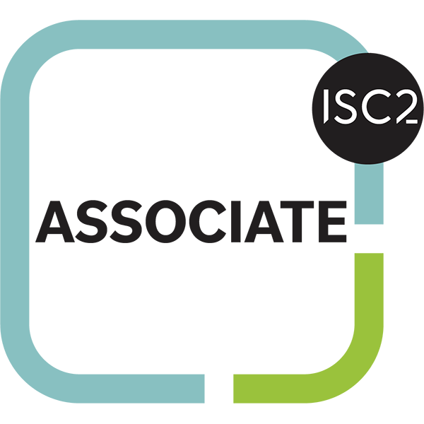

# Cybersecurity & IT Professional

# Hi there, I'm Will! 👋

I'm a Cybersecurity and Information Assurance graduate from Western Governors University with a strong interest in IT infrastructure, cybersecurity, and security operations.

I'm passionate about understanding how systems work, troubleshooting technical issues, and developing practical skills through hands-on projects and continuous learning.

I enjoy exploring different areas of information technology, working with new tools and technologies, and applying technical concepts to real-world scenarios. Through hands-on projects, I aim to strengthen my problem-solving abilities and build a well-rounded technical skill set.

I'm currently expanding my technical knowledge, building my cybersecurity portfolio, and pursuing opportunities in IT support and cybersecurity where I can continue learning and contribute to a team.

<h2> Certifications</h2>

  
  
  
  
  
  
  
  

